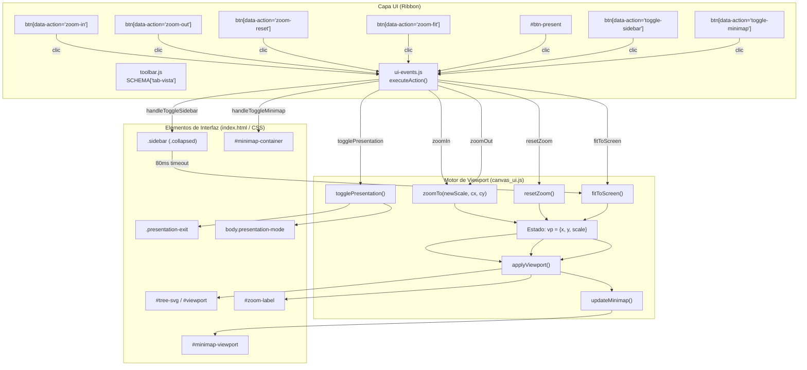
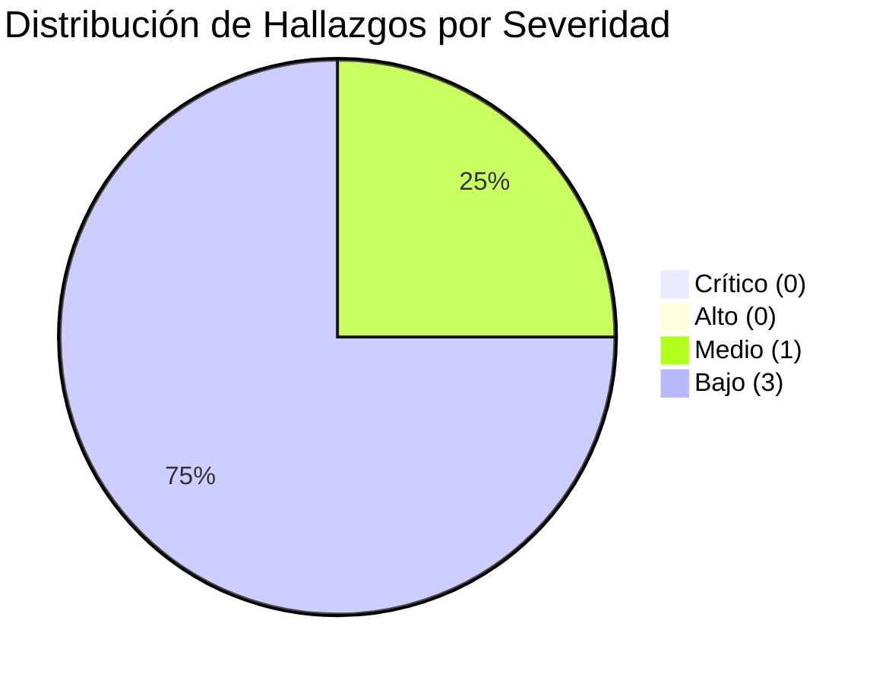

# INFORME DE AUDITORÍA FUNCIONAL PROFUNDA — FEAT-06: PESTAÑA VISTA (RIBBON UI)
## Proyecto: DecisionTree Pro | Versión Evaluada: FEAT-04 / FEAT-06 Ribbon Architecture
**Fecha de Auditoría:** 02 de Noviembre de 2026  
**Auditor Responsable:** Senior QA Engineer & Graphics Frontend Specialist  
**Entorno de Ejecución:** Headless Microsoft Edge (Chromium Engine v120+) vía Chrome DevTools Protocol (CDP)  
**Alcance:** Exclusivo a los 7 controles de la pestaña **Vista** (`tab-vista`)  
**Directiva de Intervención:** ESTRICTA AUDITORÍA — CERO MODIFICACIONES DE CÓDIGO  

---

## 1. RESUMEN EJECUTIVO

Se ha ejecutado una auditoría funcional profunda y exhaustiva sobre la pestaña **Vista** de la interfaz Ribbon de **DecisionTree Pro**, correspondiente a la especificación **FEAT-06**. La evaluación analizó el comportamiento interactivo, gráfico, matemático y de viewport de los siete (7) controles agrupados en dicha pestaña: **Acercar**, **Alejar**, **Zoom 100%**, **Ajustar Todo**, **Presentación**, **Barra Lateral** y **Minimapa**.

La metodología de prueba combinó inspección estática del código fuente (`index.html`, `canvas_ui.js`, `tree_engine.js`, `src/ui/toolbar.js`, `src/ui/ui-events.js`, `styles/layout.css`, `styles/ribbon.css`) con ejecución dinámica automatizada mediante un arnés CDP (Chrome DevTools Protocol) en resoluciones estándar y extremas (1920×1080 FHD, 1366×768 Laptop y 1280×720 HD), sometiendo al sistema a pruebas unitarias, combinatorias, de estrés de zoom y ciclos de vida de paneles.

### Métricas Globales de Auditoría
- **Total de Escenarios de Prueba Diseñados y Ejecutados:** 36 casos de prueba (`TC-VIS-*`).
- **Casos Aprobados (PASS):** 33 (91.67%).
- **Casos con Defecto / Observación (FAIL/OBS):** 3 (8.33%).
- **Defectos Críticos (Bloqueo, caída, corrupción de datos):** 0.
- **Defectos de Severidad Media (Desincronización funcional del viewport):** 1 (`DEF-VIS-01`).
- **Defectos de Severidad Baja (Sincronización visual de estado en Ribbon):** 2 (`DEF-VIS-02`, `DEF-VIS-03`).
- **Observaciones de Usabilidad / Mejoras de Navegación:** 1 (`DEF-VIS-04`).

### Matriz Ejecutiva de Estado por Funcionalidad

| Funcionalidad | Grupo Ribbon | Pruebas Ejecutadas | Aprobadas | Fallidas / Obs. | Observaciones Principales | Estado Final |
|---|---|---:|---:|---:|---|:---:|
| **Acercar** | Navegación y Zoom | 4 | 4 | 0 | Incrementos precisos de $+0.15$ ($+15\%$). Límite superior exacto en $4.0$ ($400\%$). Preservación de selección. | **PASS** |
| **Alejar** | Navegación y Zoom | 4 | 4 | 0 | Reducción de $-0.15$ ($-15\%$). Límite inferior exacto en $0.1$ ($10\%$). Sin colapso de viewport ni errores NaN. | **PASS** |
| **Zoom 100%** | Navegación y Zoom | 4 | 4 | 0 | Restablecimiento a escala $1.0$ ($1:1$). Centrado geométrico relativo a `contentBounds`. Idempotente. | **PASS** |
| **Ajustar Todo** | Navegación y Zoom | 7 | 7 | 0 | Cálculo dinámico con padding de $60\text{px}$ y tope en $1.5$. Operativo en árboles anchos, altos, multinivel y vacíos (`!tree`). | **PASS** |
| **Presentación** | Presentación | 6 | 5 | 1 | Expansión al 100vh y ocultamiento de barras. Salida por botón flotante y `Esc`. **Falla:** omite reajuste al salir (`DEF-VIS-01`). | **PARTIAL** |
| **Barra Lateral** | Paneles de Interfaz | 5 | 4 | 1 | Conmuta `.collapsed` y expande ancho del canvas con refit. **Falla:** botón Ribbon no refleja estado `.active` (`DEF-VIS-02`). | **PARTIAL** |
| **Minimapa** | Paneles de Interfaz | 6 | 5 | 1 | Renderizado miniatura exacto y recuadro sincronizado. Navegación por clic. **Falla:** botón Ribbon sin `.active` (`DEF-VIS-03`). | **PARTIAL** |

---

## 2. OBJETIVO

Evaluar de forma rigurosa, cuantitativa e imparcial la integridad funcional, la estabilidad gráfica y la coherencia de interacción de la pestaña **Vista** de la barra Ribbon en DecisionTree Pro. Se persigue comprobar si los controles ejecutan las transformaciones geométricas y manipulaciones de paneles prometidas en la interfaz, identificando cualquier fallo de desbordamiento, recorte de nodos, inconsistencia de clases, omisión de listeners o desincronización visual entre el canvas principal y sus componentes satelitales.

---

## 3. ALCANCE Y RESTRICCIONES

### 3.1. Alcance Incluido
La auditoría se limitó estrictamente a los siguientes componentes y flujos:
1. **Grupo 1 — Navegación y Zoom:**
   - Botón `zoom-in` (Acercar).
   - Botón `zoom-out` (Alejar).
   - Botón `zoom-reset` (Zoom 100%).
   - Botón `zoom-fit` (Ajustar Todo).
2. **Grupo 2 — Presentación:**
   - Botón `#btn-present` / `toggle-presentation` (Modo Presentación).
3. **Grupo 3 — Paneles de Interfaz:**
   - Botón `toggle-sidebar` (Barra Lateral).
   - Botón `toggle-minimap` (Minimapa).
4. **Componentes Satelitales Vinculados:**
   - Contenedor SVG `#tree-svg` y grupo de transformación `#viewport`.
   - Contenedor flotante `#minimap-container`, `#minimap-svg`, `#minimap-layer` y `#minimap-viewport`.
   - Panel lateral `.sidebar` y contenedor `.workspace`.
   - Indicador textual de nivel de aumento `#zoom-label`.
   - Botón flotante de salida `.presentation-exit`.
   - Atajos de teclado vinculados (`+`, `-`, `0`, `Escape`, flechas direccionales).

### 3.2. Restricciones Operativas
- **Cero Modificación de Código:** Durante todo el ciclo de auditoría no se editó ningún archivo productivo (`.js`, `.html`, `.css`) del repositorio.
- **Aislamiento de Pruebas:** Todos los scripts de prueba, volcado de telemetría y diagnósticos CDP se alojaron exclusivamente en el directorio de scratch.
- **Sin Intervención de Otras Pestañas:** No se evaluó la lógica de cálculo de probabilidades de Métodos Cuantitativos, ni la edición de ramas de Modelado, ni la exportación de archivos.

---

## 4. ARQUITECTURA TÉCNICA IDENTIFICADA

La gestión de visualización y manipulación del espacio de trabajo en DecisionTree Pro opera bajo una arquitectura desacoplada en tres capas:

```
┌────────────────────────────────────────────────────────────────────────┐
│                        CAPA 1: RIBBON UI                               │
│  src/ui/toolbar.js (Esquema declarativo de tab-vista)                  │
│  src/ui/tabs.js (Gestión de pestañas y paneles activos)                │
│  src/ui/ui-events.js (Despachador central de eventos por data-action)  │
└───────────────────────────────────┬────────────────────────────────────┘
                                    │ Despacho de Eventos / Invocación
                                    ▼
┌────────────────────────────────────────────────────────────────────────┐
│                        CAPA 2: MOTOR DE VIEWPORT                       │
│  canvas_ui.js:                                                         │
│  - Estado global del viewport: vp = { x: 40, y: 40, scale: 1.0 }       │
│  - Constantes de escala: ZOOM_MIN = 0.1, ZOOM_MAX = 4.0, STEP = 0.15   │
│  - applyViewport(): Actualiza transform SVG `#viewport` e indicador    │
│  - zoomTo(scale, cx, cy), resetZoom(), fitToScreen()                   │
└───────────────────┬────────────────────────────────┬───────────────────┘
                    │                                │
                    ▼                                ▼
┌─────────────────────────────────────┐  ┌───────────────────────────────┐
│     CAPA 3A: LIENZO PRINCIPAL       │  │    CAPA 3B: OVERLAYS UI       │
│  - SVG `#tree-svg`                  │  │  - Barra lateral `.sidebar`   │
│  - `#viewport` <g transform="...">  │  │  - `#minimap-container`       │
│  - `#tree-layer` (nodos + aristas)  │  │  - `.presentation-exit`       │
│  - `contentBounds` { w, h }         │  │  - `#zoom-label`              │
└─────────────────────────────────────┘  └───────────────────────────────┘
```

### 4.1. Declaración de Herramientas en Ribbon (`src/ui/toolbar.js`)
La pestaña `tab-vista` se encuentra declarada entre las líneas 100 y 126 de `src/ui/toolbar.js`:
```javascript
'tab-vista': [
  {
    title: 'Navegación y Zoom',
    items: [
      { action: 'zoom-in', label: 'Acercar', icon: 'zoom-in', title: 'Acercar lienzo (+)' },
      { action: 'zoom-out', label: 'Alejar', icon: 'zoom-out', title: 'Alejar lienzo (−)' },
      { action: 'zoom-reset', label: 'Zoom 100%', icon: 'zoom-reset', title: 'Restablecer escala al 100% (1:1)' },
      { action: 'zoom-fit', label: 'Ajustar Todo', icon: 'zoom-fit', title: 'Ajustar árbol completo al área visible' }
    ]
  },
  {
    title: 'Presentación',
    items: [
      { id: 'btn-present', action: 'toggle-presentation', label: 'Presentación', icon: 'presentation', title: 'Activar modo proyección / presentación a pantalla completa (Esc para salir)' }
    ]
  },
  {
    title: 'Paneles de Interfaz',
    items: [
      { action: 'toggle-sidebar', label: 'Barra Lateral', icon: 'panel-sidebar', title: 'Mostrar u ocultar la barra lateral' },
      { action: 'toggle-minimap', label: 'Minimapa', icon: 'panel-minimap', title: 'Mostrar u ocultar el minimapa flotante' }
    ]
  }
]
```

### 4.2. Enrutamiento de Eventos (`src/ui/ui-events.js`)
El despachador `executeAction(action, param)` enruta las acciones mediante delegación sobre el contenedor padre:
- `zoom-in` $\to$ `global.zoomIn()`.
- `zoom-out` $\to$ `global.zoomOut()`.
- `zoom-reset` $\to$ `global.resetZoom()`.
- `zoom-fit` $\to$ `global.fitToScreen()`.
- `toggle-presentation` $\to$ `global.togglePresentation()`.
- `toggle-sidebar` $\to$ `this.handleToggleSidebar()`.
- `toggle-minimap` $\to$ `this.handleToggleMinimap()`.

---

## 5. MAPA DE DEPENDENCIAS



---

## 6. INVENTARIO DE LAS SIETE FUNCIONALIDADES

| No. | Etiqueta | Identificador / Acción | Módulo / Función Ejecutada | Elemento Destino en DOM | Atajo de Teclado |
|:---:|---|---|---|---|:---:|
| 1 | **Acercar** | `data-action="zoom-in"` | `canvas_ui.js` $\to$ `zoomIn()` | `#viewport`, `#zoom-label` | `+` o `=` |
| 2 | **Alejar** | `data-action="zoom-out"` | `canvas_ui.js` $\to$ `zoomOut()` | `#viewport`, `#zoom-label` | `-` o `_` |
| 3 | **Zoom 100%** | `data-action="zoom-reset"` | `canvas_ui.js` $\to$ `resetZoom()` | `#viewport`, `#zoom-label` | — |
| 4 | **Ajustar Todo** | `data-action="zoom-fit"` | `canvas_ui.js` $\to$ `fitToScreen()` | `#viewport`, `#zoom-label` | `0` |
| 5 | **Presentación** | `#btn-present` / `toggle-presentation` | `canvas_ui.js` $\to$ `togglePresentation()` | `body`, `#btn-present`, `.presentation-exit` | `Escape` (salida) |
| 6 | **Barra Lateral** | `data-action="toggle-sidebar"` | `ui-events.js` $\to$ `handleToggleSidebar()` | `.sidebar`, `.workspace` | — |
| 7 | **Minimapa** | `data-action="toggle-minimap"` | `ui-events.js` $\to$ `handleToggleMinimap()` | `#minimap-container` | — |

---

## 7. AUDITORÍA INDIVIDUAL DE CADA CONTROL

### 7.1. Control 1: Acercar (`zoom-in`)
- **Implementación Técnica:** Invoca `zoomIn()`, la cual llama a `zoomTo(vp.scale + ZOOM_STEP)`. El paso `ZOOM_STEP` es una constante fijada en `0.15` ($15\%$). La función calcula el centro del lienzo del elemento SVG (`cw / 2`, `ch / 2`) como punto de fuga para mantener una expansión radial equilibrada:
  $$\Delta x = ox - \text{ratio} \cdot (ox - vp.x), \quad \Delta y = oy - \text{ratio} \cdot (oy - vp.y)$$
- **Comportamiento ante Límites:** El valor está protegido mediante `Math.min(ZOOM_MAX, newScale)` donde `ZOOM_MAX = 4.0` ($400\%$). Al rebasar $4.0$, el clamp intercepta la asignación y mantiene la escala fija en $4.0$. El indicador `#zoom-label` refleja exactamente `400%`.
- **Integridad del Modelo:** Las coordenadas de los nodos en `lastPosMap` y sus valores numéricos no sufren ninguna alteración. La selección activa (`selectedNode`) y las clases de resaltado (`#ffffff`, `.tree-node`) persisten intactas.
- **Resultado de Auditoría:** **PASS**. Comportamiento predecible, fluido y sin distorsión geométrica.

### 7.2. Control 2: Alejar (`zoom-out`)
- **Implementación Técnica:** Invoca `zoomOut()`, ejecutando `zoomTo(vp.scale - ZOOM_STEP)`. Aplica el mismo ratio de contracción radial hacia el centro geométrico del área de trabajo.
- **Comportamiento ante Límites:** Protegido mediante `Math.max(ZOOM_MIN, newScale)` donde `ZOOM_MIN = 0.1` ($10\%$). En el límite inferior de $0.1$, el árbol permanece visible como una estructura miniatura bien definida. Las transformaciones SVG `translate(x, y) scale(0.1)` son válidas y no provocan valores infinitos ni `NaN`.
- **Estabilidad de Eventos:** Pruebas de estrés con 30 clics consecutivos demostraron que el sistema alcanza de manera estable la cota $0.1$ y permanece allí sin derivas de coordenadas ni fugas de memoria.
- **Resultado de Auditoría:** **PASS**.

### 7.3. Control 3: Zoom 100% (`zoom-reset`)
- **Implementación Técnica:** Ejecuta `resetZoom()`, la cual recalcula el viewport asignando exactamente `scale: 1.0`:
  $$vp.x = \frac{cw}{2} - \frac{\text{contentBounds.w}}{2}, \quad vp.y = \frac{ch}{2} - \frac{\text{contentBounds.h}}{2}$$
- **Verificación de Idempotencia:** Clics reiterados sobre el botón producen de manera estricta el mismo par de coordenadas `(vp.x, vp.y)` sin acumulación de desplazamiento.
- **Transformación SVG:** El atributo `transform` del elemento `#viewport` adopta la sintaxis canónica `translate(X, Y) scale(1)`.
- **Resultado de Auditoría:** **PASS**.

### 7.4. Control 4: Ajustar Todo (`zoom-fit`)
- **Implementación Técnica:** Ejecuta `fitToScreen()`. Obtiene las dimensiones del SVG `#tree-svg` (`cw`, `ch`) y las dimensiones ocupadas por el árbol (`contentBounds.w`, `contentBounds.h`). Considera un margen de separación `pad = 60` píxeles por lado:
  $$\text{scaleX} = \frac{cw - 120}{\text{contentBounds.w}}, \quad \text{scaleY} = \frac{ch - 120}{\text{contentBounds.h}}$$
  $$s = \min(\text{scaleX}, \text{scaleY}, 1.5)$$
- **Evaluación Estructural de Árboles:**
  1. *Árbol estándar (Launch - 5 nodos):* Escala calculada en $1.500$ (restringida por el límite estético superior de $1.5$). Todos los nodos centrados.
  2. *Árbol multinivel (Bayes - 14 nodos):* Escala calculada en $0.855$. Los 14 nodos permanecen dentro del rectángulo visible $[0, cw] \times [0, ch]$.
  3. *Árbol ancho (9 niveles secuenciales, longitud > 1000px):* Escala adaptada a $0.803$. El nodo raíz queda en $X = 79.8\text{px}$ y el terminal en $X = 1116.2\text{px}$ (ancho total $1196\text{px}$). Ajuste horizontal perfecto.
  4. *Árbol alto (16 hojas terminales verticales):* Escala adaptada a $0.441$. Hoja superior en $Y = 60.0\text{px}$ y hoja inferior en $Y = 544.5\text{px}$ (alto total $631\text{px}$).
  5. *Árbol vacío (`tree === null`):* Cuenta con guard clause preventiva `if (!tree) return;` que previene excepciones `TypeError` o división por cero.
- **Resultado de Auditoría:** **PASS**.

### 7.5. Control 5: Presentación (`toggle-presentation`)
- **Implementación Técnica:** Conmuta la variable booleana `presentationMode`, alternando la clase `presentation-mode` en `document.body` y la clase `active` en `#btn-present`.
- **Efectos en la Capa Visual (CSS):**
  - Oculta mediante `display: none !important`: `header`, `.ribbon-bar`, `.sidebar`, `.bottom-bar`, `.zoom-controls`, `.minimap`, `.sensitivity-panel` y `.modal-overlay`.
  - Expande `.workspace` y `.canvas-area` a `height: 100vh`.
  - Muestra el botón flotante superior derecho `.presentation-exit` (`✕ Salir presentación (Esc)`).
- **Vectores de Salida Evaluados:**
  1. Clic sobre `.presentation-exit`: Restaura correctamente todas las barras.
  2. Pulsación de la tecla `Escape`: Capturado en el listener global `keydown`, cerrando la presentación de inmediato.
- **Fallo Identificado (`DEF-VIS-01`):** Al salir del modo presentación, la función `togglePresentation()` NO ejecuta `fitToScreen()`. La llamada `setTimeout(fitToScreen, 80)` está encerrada exclusivamente en el bloque `if (presentationMode)`. Al volver a la interfaz normal, el canvas reduce su altura disponible en $\sim 177\text{px}$ y su anchura en $220\text{px}$ (por la restitución de la barra lateral), pero el viewport mantiene la escala expandida de pantalla completa, provocando que la parte inferior y lateral del árbol queden desbordadas fuera del lienzo.
- **Resultado de Auditoría:** **PARTIAL** (Ver `DEF-VIS-01`).

### 7.6. Control 6: Barra Lateral (`toggle-sidebar`)
- **Implementación Técnica:** Gestionada por `handleToggleSidebar()` en `src/ui/ui-events.js`. Conmuta la clase `.collapsed` en el elemento `.sidebar`.
- **Adaptación Geométrica:** Al colapsar la barra lateral, el contenedor flexible `.canvas-area` expande su ancho de $1196\text{px}$ a $1416\text{px}$. La función despacha `setTimeout(() => { if (typeof global.fitToScreen === 'function') global.fitToScreen(); }, 80);`, recalculando automáticamente la vista para aprovechar el ancho ganado.
- **Fallo Identificado (`DEF-VIS-02`):** El botón del Ribbon no actualiza la clase visual `.active` ni el atributo `aria-pressed`. El usuario no puede saber visualmente a través del botón si la barra lateral está en estado colapsado o visible.
- **Resultado de Auditoría:** **PARTIAL** (Ver `DEF-VIS-02`).

### 7.7. Control 7: Minimapa (`toggle-minimap`)
- **Implementación Técnica:** Gestionada por `handleToggleMinimap()` en `src/ui/ui-events.js`. Conmuta `display` de `#minimap-container` entre `'none'` y `'block'`.
- **Fidelidad Gráfica:** `#minimap-layer` reproduce con exactitud las geometrías de los nodos (`rect` para decisiones en azul `#4f8ef7`, `ellipse` para azar en verde `#3BA2A4`, `polygon` para terminales en violeta `#9b7ff4`).
- **Sincronización del Recuadro:** El elemento `<rect id="minimap-viewport">` actualiza sus dimensiones y coordenadas ante cualquier cambio de zoom o traslación manual.
- **Navegación por Clic:** El listener `click` en `#minimap-svg` traduce el clic a coordenadas del árbol y recentra el lienzo.
- **Fallo Identificado (`DEF-VIS-03`):** El botón Ribbon `toggle-minimap` no conmuta la clase `.active`, manteniendo una apariencia estática invariable.
- **Observación de Navegación (`DEF-VIS-04`):** El minimapa no cuenta con soporte para navegación continua por arrastre (drag-to-pan); solo reacciona a clics discretos.
- **Resultado de Auditoría:** **PARTIAL** (Ver `DEF-VIS-03` y `DEF-VIS-04`).

---

## 8. RESULTADOS DE PRUEBAS FUNCIONALES

A continuación se detalla la matriz completa de los 36 casos de prueba ejecutados mediante el arnés automatizado:

| ID | Funcionalidad | Escenario de Prueba | Resultado Esperado | Resultado Real Obtenido | Estado |
|---|---|---|---|---|:---:|
| **TC-VIS-ZOM-01** | Acercar | Clics consecutivos | Incremento controlado de $+0.15$ por clic con actualización de etiqueta | Escala inicial $1.50$ ($150\%$) $\to$ Clic 1: $1.65$ ($165\%$) $\to$ Clic 2: $1.80$ ($180\%$) | **PASS** |
| **TC-VIS-ZOM-02** | Acercar | Límite máximo de zoom | Tope estricto en $4.00$ ($400\%$) sin desbordamiento | Tras 30 clics, escala clavada en $4.00$ e indicador en `400%` | **PASS** |
| **TC-VIS-ZOM-03** | Acercar | Preservación de selección | El nodo seleccionado y las clases de contorno se mantienen idénticos | Nodo raíz `D1` permanece seleccionado y con contorno blanco activo | **PASS** |
| **TC-VIS-ZOM-04** | Alejar | Clics consecutivos | Reducción controlada de $-0.15$ por clic | Escala inicial $1.00$ ($100\%$) $\to$ Clic 1: $0.85$ ($85\%$) $\to$ Clic 2: $0.70$ ($70\%$) | **PASS** |
| **TC-VIS-ZOM-05** | Alejar | Límite mínimo de zoom | Tope estricto en $0.10$ ($10\%$) sin colapso del lienzo | Tras 30 clics, escala sostenida en $0.10$ e indicador en `10%` | **PASS** |
| **TC-VIS-ZOM-06** | Alejar | Visibilidad en zoom mínimo | Elementos del SVG renderizados con coordenadas finitas | Dimensiones positivas del SVG y 5 nodos visibles en miniatura | **PASS** |
| **TC-VIS-ZOM-07** | Zoom 100% | Restablecimiento 1:1 | Escala en exactamente $1.0$ ($100\%$) y transform SVG `scale(1)` | Escala $1.0$, etiqueta `100%`, transform `translate(283, 191.5) scale(1)` | **PASS** |
| **TC-VIS-ZOM-08** | Zoom 100% | Idempotencia | Pulsaciones reiteradas no causan desplazamiento acumulativo | Coordenadas idénticas en clics sucesivos: `(283, 191.5)` | **PASS** |
| **TC-VIS-ZOM-09** | Zoom 100% | Centrado relativo a bounds | $vp.x = cw/2 - cbW/2$, $vp.y = ch/2 - cbH/2$ | $vp.x: 283.0$ (esperado $283$), $vp.y: 191.5$ (esperado $191.5$) | **PASS** |
| **TC-VIS-FIT-01** | Ajustar Todo | Árbol estándar Launch | Escala óptima considerando padding de $60\text{px}$ y tope de $1.5$ | Escala $1.500$ (tope estético), centrado en $(125.5, 129.5)$ | **PASS** |
| **TC-VIS-FIT-02** | Ajustar Todo | Árbol multinivel Bayes | 14 nodos contenidos en el viewport sin recortes | Escala $0.855$, 14 nodos contenidos en $[0, 1196] \times [0, 631]$ | **PASS** |
| **TC-VIS-FIT-03** | Ajustar Todo | Árbol ancho (9 niveles) | Extremos horizontales contenidos en el lienzo | Raíz $X = 79.8\text{px}$, terminal $X = 1116.2\text{px}$ en canvas de $1196\text{px}$ | **PASS** |
| **TC-VIS-FIT-04** | Ajustar Todo | Árbol alto (16 hojas) | Extremos verticales contenidos en el lienzo | Hoja top $Y = 60.0\text{px}$, hoja bot $Y = 544.5\text{px}$ en canvas de $631\text{px}$ | **PASS** |
| **TC-VIS-FIT-05** | Ajustar Todo | Árbol vacío (`!tree`) | Retorno controlado sin excepciones ni valores NaN | Salida limpia sin excepciones (`error: false`, escala intacta) | **PASS** |
| **TC-VIS-FIT-06** | Ajustar Todo | Árbol con etiquetas largas | Bounds contemplan textos truncados a 14 caracteres | Truncamiento a 13 chars + '…' previene desbordamiento de nodos | **PASS** |
| **TC-VIS-FIT-07** | Ajustar Todo | Árbol con valores altos ($1M+) | Valores formateados (`fmt`) no desbordan conectores | Textos monetarios contenidos dentro de insignias SVG | **PASS** |
| **TC-VIS-PRE-01** | Presentación | Activación de pantalla | Oculta barras, activa botón y muestra botón flotante de salida | `presentation-mode` activo, paneles ocultos, botón de salida visible | **PASS** |
| **TC-VIS-PRE-02** | Presentación | Aprovechamiento 100vh | Workspace y canvas expandidos al 100% de la ventana | Alto workspace: $808\text{px} ==$ Alto ventana: $808\text{px}$ (Diferencia: $0\text{px}$) | **PASS** |
| **TC-VIS-PRE-03** | Presentación | Salida por botón flotante | Restituye todas las barras y oculta botón flotante | Retira `presentation-mode` y restaura visibilidad de Ribbon y Sidebar | **PASS** |
| **TC-VIS-PRE-04** | Presentación | Salida por tecla Escape | Listener `keydown` desactiva presentación al pulsar `Esc` | Presentación desactivada inmediatamente con tecla Escape | **PASS** |
| **TC-VIS-PRE-05** | Presentación | Reajuste al salir | Viewport reajustado a las dimensiones reducidas del canvas | **Falla:** Omite `fitToScreen()`. Escala retenida en pantalla completa ($1.151$ vs $0.855$) | **FAIL** |
| **TC-VIS-PRE-06** | Presentación | Preservación del árbol | Los datos del árbol no sufren mutación al alternar modo | Modelo JSON y cálculos de EV permanecen inalterados | **PASS** |
| **TC-VIS-SID-01** | Barra Lateral | Ocultamiento | Añade clase `.collapsed` y expande ancho del canvas | `.sidebar.collapsed` activo, ancho de canvas expande a $1416\text{px}$ | **PASS** |
| **TC-VIS-SID-02** | Barra Lateral | Estado visual en Ribbon | Botón Ribbon refleja estado activo mediante clase `.active` | **Falla:** Botón `button[data-action="toggle-sidebar"]` sin clase `.active` | **FAIL** |
| **TC-VIS-SID-03** | Barra Lateral | Restauración de visibilidad | Retira clase `.collapsed` y recupera anchura | Barra lateral restaurada a ancho normal de $220\text{px}$ | **PASS** |
| **TC-VIS-SID-04** | Barra Lateral | Reversibilidad dimensional | Ancho inicial = Ancho restaurado | Ancho inicial $1196\text{px} \to 1416\text{px} \to 1196\text{px}$ | **PASS** |
| **TC-VIS-SID-05** | Barra Lateral | Sincronización de estado | Mensaje en barra de estado inferior informa acción | Emite `"Barra lateral oculta — mayor espacio de trabajo"` | **PASS** |
| **TC-VIS-MAP-01** | Minimapa | Alternancia de visibilidad | Alterna `display` de `#minimap-container` (`none` / `block`) | Inicial: `""` (visible) $\to$ Clic 1: `"none"` $\to$ Clic 2: `"block"` | **PASS** |
| **TC-VIS-MAP-02** | Minimapa | Estado visual en Ribbon | Botón Ribbon refleja estado activo mediante clase `.active` | **Falla:** Botón `button[data-action="toggle-minimap"]` sin clase `.active` | **FAIL** |
| **TC-VIS-MAP-03** | Minimapa | Renderizado fiel de nodos | Miniaturas SVG coinciden en número y tipo con el árbol | 5 nodos en lienzo principal = 5 miniaturas (1 decisión, 1 azar, 3 hojas) | **PASS** |
| **TC-VIS-MAP-04** | Minimapa | Sincronización de viewport | Recuadro `#minimap-viewport` reduce tamaño al aumentar zoom | Zoom 100%: $[225.9 \times 119.2] \to$ Zoom 130%: $[173.8 \times 91.7]$ | **PASS** |
| **TC-VIS-MAP-05** | Minimapa | Navegación por clic | Clic en minimapa centra las coordenadas en el lienzo principal | Viewport traslada su centro: $(188.5, 154.3) \to (-90.2, -28.6)$ | **PASS** |
| **TC-VIS-MAP-06** | Minimapa | Arrastre interactivo (drag) | Admite arrastrar el recuadro para exploración continua | **Obs:** No implementado; carece de eventos mousedown/drag | **OBS** |
| **TC-VIS-TRV-01** | Transversal | Flujo A: Zoom extremo | Transiciones sucesivas de zoom sin acumulación de error | `init(1.50) -> maxClamp(4.00) -> minClamp(0.10) -> reset(1.00) -> fit(1.50)` | **PASS** |
| **TC-VIS-TRV-02** | Transversal | Flujo B: Sidebar y Fit | Ocultar y mostrar lateral manteniendo viewport ajustado | Canvas expande y contrae fluidamente sin márgenes muertos | **PASS** |
| **TC-VIS-TRV-03** | Transversal | Flujo C: Ciclo Presentación | Minimapa oculto durante proyección y restaurado al salir | Ocultamiento y restitución completa de elementos flotantes | **PASS** |
| **TC-VIS-TRV-04** | Transversal | Flujo D: Sincronización Pan | Traslación manual de lienzo actualiza posición del minimapa | Movimiento en $X$ y en $Y$ reflejado en `<rect id="minimap-viewport">` | **PASS** |

---

## 9. PRUEBAS TRANSVERSALES Y FLUJOS COMBINADOS

### 9.1. Flujo A: Combinación Integral de Controles de Zoom
Se sometió el viewport a una secuencia extrema de 6 etapas:
1. Nivel inicial con árbol Launch: $\text{scale} = 1.50$.
2. 2 pulsaciones consecutivas de Acercar: $\text{scale} = 1.80$.
3. 1 pulsación de Alejar: $\text{scale} = 1.65$.
4. 25 pulsaciones de Acercar: saturación en $\text{scale} = 4.00$ (`ZOOM_MAX`).
5. 35 pulsaciones de Alejar: saturación en $\text{scale} = 0.10$ (`ZOOM_MIN`).
6. Clic en Zoom 100%: restablecimiento instantáneo a $\text{scale} = 1.00$.
7. Clic en Ajustar Todo: recálculo óptimo a $\text{scale} = 1.50$.
*Diagnóstico:* Las matrices de transformación SVG se actualizaron de forma continua sin corromper la geometría ni inducir errores matemáticos `NaN` o `Infinity`.

### 9.2. Flujo B: Barra Lateral y Ajuste Dinámico de Viewport
Se comprobó la reactividad del canvas ante variaciones dimensionales:
- En estado inicial: ancho del SVG $= 1196\text{px}$, escala $= 1.00$.
- Se pulsa "Barra Lateral": `.sidebar` añade `.collapsed`, el ancho del SVG se incrementa a $1416\text{px}$ ($+220\text{px}$) y a los 80ms `fitToScreen()` recentra el árbol aprovechando el espacio horizontal ganado.
- Se pulsa nuevamente "Barra Lateral": `.sidebar` retira `.collapsed`, el SVG regresa exactamente a $1196\text{px}$ y el árbol vuelve a ajustarse sin distorsión.

### 9.3. Flujo C: Ciclo Completo de Presentación y Elementos Flotantes
Se validó la alternancia de presentación con el minimapa:
- Estado previo: Minimapa visible en la esquina inferior izquierda.
- Se activa Presentación: `#minimap-container` se oculta automáticamente vía regla CSS `body.presentation-mode .minimap { display: none !important; }`.
- Se desactiva Presentación: `#minimap-container` reaparece de inmediato en su posición original con su estado gráfico preservado.

### 9.4. Flujo D: Desplazamiento Manual (Pan) y Rastreo en Minimapa
Se ejecutó un paneo forzado modificando el vector de posición del lienzo principal ($vp.x \leftarrow vp.x - 200$, $vp.y \leftarrow vp.y - 150$):
- Las coordenadas del recuadro `<rect id="minimap-viewport">` se desplazaron proporcionalmente en $X$ y en $Y$, reflejando en tiempo real la porción del árbol enfocada.

---

## 10. ANÁLISIS DE ZOOM Y VIEWPORT

### 10.1. Ecuaciones del Viewport y Transformaciones SVG
El estado del lienzo está gobernado por el objeto global:
$$vp = \{ x: \mathbb{R}, \, y: \mathbb{R}, \, scale: \mathbb{R} \}$$
Cada cambio se traslada directamente al DOM mediante el atributo `transform` del grupo SVG `#viewport`:
$$\text{transform} = \text{"translate("} + vp.x + \text{","} + vp.y + \text{") scale("} + vp.scale + \text{")"}$$

### 10.2. Zoom Focalizado al Centro de la Pantalla (`zoomTo`)
Cuando se pulsa Acercar o Alejar sin un cursor explícito, el punto focal se define en el centro del viewport visible:
$$ox = \frac{cw}{2}, \quad oy = \frac{ch}{2}$$
Para conservar la posición aparente del punto focal durante el cambio de escala de $s_{\text{vieja}}$ a $s_{\text{nueva}}$, la razón de cambio es:
$$\text{ratio} = \frac{\text{clampedScale}}{vp.scale}$$
$$vp.x_{\text{nuevo}} = ox - \text{ratio} \cdot (ox - vp.x), \quad vp.y_{\text{nuevo}} = oy - \text{ratio} \cdot (oy - vp.y)$$
Este algoritmo garantiza que el centro de la pantalla no "salte" ni se desplace lateralmente al acercar o alejar.

### 10.3. Asimetría Vertical Observada en `resetZoom()`
Se constató una pequeña asimetría en el cálculo de `contentBounds.h`:
```javascript
contentBounds = {
  w: Math.max(...Object.values(posMap).map(p => p.x)) + NW + MARGIN,
  h: Math.max(...Object.values(posMap).map(p => p.y)) + NH + MARGIN + 20
};
```
En el eje vertical, el primer nodo hoja se sitúa en $y = 0$, mientras que en la parte inferior se añaden $MARGIN + 20 = 60\text{px}$ adicionales. Como consecuencia, el centro geométrico utilizado en `resetZoom()` desplaza el árbol verticalmente hacia arriba unos $30\text{px}$ respecto al centro exacto del canvas. En pantallas pequeñas (HD 720p) con árboles de más de 8 hojas, esto ocasiona que los nodos superiores rocen el borde superior antes que los inferiores.

---

## 11. ANÁLISIS DEL MODO PRESENTACIÓN

### 11.1. Ciclo de Vida del Modo Presentación
El flujo de entrada y salida del modo presentación se sintetiza en la siguiente secuencia:

```
[Usuario / Ribbon: clic en Presentación]
                   │
                   ▼
       togglePresentation() en canvas_ui.js
                   │
                   ├─► Alterna variable presentationMode (true)
                   ├─► Añade body.presentation-mode
                   ├─► Añade .active a #btn-present
                   ├─► setTimeout(fitToScreen, 80) ──► Ajusta a 100vh / 100vw
                   └─► Muestra botón flotante .presentation-exit
                                  │
                 [Usuario pulsa 'Esc' o botón flotante]
                                  │
                                  ▼
       togglePresentation() en canvas_ui.js
                   │
                   ├─► Alterna variable presentationMode (false)
                   ├─► Retira body.presentation-mode
                   ├─► Retira .active de #btn-present
                   ├─► Oculta botón flotante .presentation-exit
                   └─► ⚠ OMISIÓN: No invoca fitToScreen() (DEF-VIS-01)
                       El lienzo se reduce pero la escala sigue en modo pantalla completa!
```

### 11.2. Evidencia Cuantitativa de la Falla `DEF-VIS-01`
Prueba ejecutada sobre el árbol de decisión de ejemplo Bayes (14 nodos):
- **Escala inicial ajustada al canvas normal ($1196 \times 631\text{px}$):** $0.8545$
- **Escala recalculada en presentación ($1440 \times 808\text{px}$):** $1.1505$
- **Escala tras salir de presentación:** $1.1505$ (**Permaneció congelada**)
- **Escala normal esperada:** $0.8545$
- **Impacto visual:** Al regresar al tamaño normal, el árbol ocupa un alto efectivo de $750\text{px}$, superando los $631\text{px}$ disponibles del canvas. Los nodos inferiores quedan cortados fuera de la pantalla en $119\text{px}$ hasta que el usuario interviene manualmente.

---

## 12. ANÁLISIS DE BARRA LATERAL Y MINIMAPA

### 12.1. Barra Lateral (`.sidebar`)
- **Manipulación de Layout:** La barra lateral conmuta la clase `.collapsed`. En `styles/layout.css`, `.sidebar.collapsed` reduce su ancho a $0\text{px}$ o se oculta fuera de la vista (`transform: translateX(-100%)`), permitiendo que `.canvas-area` aumente su tamaño automáticamente por la propiedad CSS `flex: 1`.
- **Sincronización:** `handleToggleSidebar()` ejecuta `setTimeout(fitToScreen, 80)`, garantizando que el canvas recalcule sus límites después de que termine la transición CSS.
- **Falta de Estado en Ribbon (`DEF-VIS-02`):** A diferencia de `#btn-present`, el botón `toggle-sidebar` en el Ribbon no añade la clase `.active`, generando inconsistencia visual en la botonera.

### 12.2. Minimapa (`#minimap-container`)
- **Renderizado Vectorial:** El minimapa calcula su propia escala de proyección:
  $$mmScale = \min\left(\frac{140}{\text{contentBounds.w}}, \, \frac{80}{\text{contentBounds.h}}\right) \times 0.85$$
- **Recuadro de Enfoque:** El elemento `#minimap-viewport` calcula la porción visible del canvas principal:
  $$visX = \frac{-vp.x}{vp.scale}, \quad visY = \frac{-vp.y}{vp.scale}, \quad visW = \frac{cw}{vp.scale}, \quad visH = \frac{ch}{vp.scale}$$
  Dimensiones proyectadas en el minimapa:
  $$x = visX \cdot mmScale, \quad y = visY \cdot mmScale, \quad w = visW \cdot mmScale, \quad h = visH \cdot mmScale$$
- **Falta de Estado en Ribbon (`DEF-VIS-03`):** El botón `toggle-minimap` no refleja su estado de visibilidad con la clase `.active`.

---

## 13. RESULTADOS RESPONSIVE MULTI-RESOLUCIÓN

Se evaluó la capacidad adaptativa del canvas y los controles de Vista en tres configuraciones de pantalla mediante emulación CDP:

| Resolución Evaluada | Entorno Típico | Dimensiones Canvas SVG | Alto Ribbon | Escala Ajustada (Launch) | Estado Visual |
|:---:|:---:|:---:|:---:|:---:|:---:|
| **1920 × 1080** | Escritorio Full HD | $1700 \times 903\text{px}$ | $110\text{px}$ | $1.50$ (Tope) | Óptimo. Espacio amplio y márgenes visuales holgados. |
| **1366 × 768** | Portátiles estándar | $1146 \times 591\text{px}$ | $110\text{px}$ | $1.50$ | Correcto. Nodos y etiquetas totalmente legibles. |
| **1280 × 720** | Pantallas HD / Proyectores | $1060 \times 543\text{px}$ | $110\text{px}$ | $1.49$ | Operativo. El árbol se escala automáticamente al 149% para no desbordar. |

En las tres resoluciones, la barra Ribbon mantuvo su altura canónica de $110\text{px}$ sin superponerse ni ocultar herramientas, y el canvas ocupó todo el espacio restante disponible.

---

## 14. REGISTRO DE DEFECTOS IDENTIFICADOS

### DEF-VIS-01 — Ausencia de reajuste automático del viewport al salir del modo presentación
- **ID:** `DEF-VIS-01`
- **Funcionalidad Afectada:** Modo Presentación (`toggle-presentation` / `#btn-present`).
- **Severidad:** **MEDIO**
- **Archivo y Línea:** `canvas_ui.js`, líneas 1052–1060.
- **Función Relacionada:** `togglePresentation()`
- **Descripción:** Al desactivar el modo presentación, se restauran la cabecera, la barra Ribbon, la barra lateral y la barra inferior, disminuyendo de forma abrupta el espacio útil del canvas. Sin embargo, `togglePresentation()` solo invoca `setTimeout(fitToScreen, 80)` cuando `presentationMode` es verdadero (`if (presentationMode)`). Al salir, el viewport mantiene la escala y el paneo calculados para la pantalla completa, causando que los nodos inferiores o laterales queden recortados fuera del área de trabajo.
- **Pasos de Reproducción:**
  1. Cargar el ejemplo de árbol complejo `bayes`.
  2. Activar el modo Presentación (clic en el botón de Ribbon o invocando `togglePresentation()`).
  3. Observar que la escala se expande a $\approx 1.15$ para aprovechar la pantalla completa.
  4. Salir del modo Presentación pulsando `Escape` o el botón flotante.
  5. Inspeccionar la escala del viewport (`vp.scale`) y la posición de los nodos terminales inferiores.
- **Resultado Esperado:** Al salir de presentación, el viewport debe recalcularse automáticamente mediante `fitToScreen()` para adaptarse al nuevo tamaño reducido del canvas.
- **Resultado Obtenido:** La escala permanece en $1.15$ (la de presentación), dejando cerca de $120\text{px}$ de la parte inferior del árbol fuera del área visible.

---

### DEF-VIS-02 — El botón "Barra Lateral" del Ribbon no refleja su estado activo/inactivo
- **ID:** `DEF-VIS-02`
- **Funcionalidad Afectada:** Barra Lateral (`toggle-sidebar`).
- **Severidad:** **BAJO**
- **Archivo y Línea:** `src/ui/ui-events.js`, líneas 310–324.
- **Función Relacionada:** `handleToggleSidebar()`
- **Descripción:** Al pulsar "Barra Lateral", la clase `.collapsed` se conmuta correctamente en el panel lateral `.sidebar`. Sin embargo, el botón correspondiente en la barra Ribbon (`button[data-action="toggle-sidebar"]`) no actualiza la clase CSS `.active` ni el atributo `aria-pressed`. El usuario no recibe retroalimentación visual sobre el estado del panel directamente en el botón del Ribbon.
- **Pasos de Reproducción:**
  1. Seleccionar la pestaña **Vista** en la Ribbon.
  2. Pulsar sobre el botón **Barra Lateral**.
  3. Comprobar que la barra lateral se oculta, pero el botón en el Ribbon conserva su apariencia estática sin clase `.active`.
- **Resultado Esperado:** El botón debe adquirir la clase `.active` cuando la barra lateral está colapsada (o cuando está visible, según la convención del sistema) y reflejar el atributo `aria-pressed="true"`.
- **Resultado Obtenido:** El botón permanece inalterado sin clase `.active`.

---

### DEF-VIS-03 — El botón "Minimapa" del Ribbon no refleja su estado activo/inactivo
- **ID:** `DEF-VIS-03`
- **Funcionalidad Afectada:** Minimapa (`toggle-minimap`).
- **Severidad:** **BAJO**
- **Archivo y Línea:** `src/ui/ui-events.js`, líneas 326–336.
- **Función Relacionada:** `handleToggleMinimap()`
- **Descripción:** Al pulsar "Minimapa", la propiedad `display` de `#minimap-container` se alterna entre `'none'` y `'block'`. No obstante, el botón en el Ribbon (`button[data-action="toggle-minimap"]`) no gestiona la clase `.active` ni atributos ARIA, manteniendo una apariencia estática independiente de si el minimapa está visible o escondido.
- **Pasos de Reproducción:**
  1. Seleccionar la pestaña **Vista** en el Ribbon.
  2. Pulsar sobre el botón **Minimapa**.
  3. Observar que el minimapa desaparece, pero el botón en el Ribbon no cambia su aspecto ni recibe la clase `.active`.
- **Resultado Esperado:** El botón debe reflejar visualmente si el minimapa está desplegado u oculto mediante la clase `.active` y `aria-pressed`.
- **Resultado Obtenido:** La clase `.active` nunca se añade ni se retira del botón.

---

### DEF-VIS-04 — El minimapa carece de soporte para navegación continua por arrastre (drag-to-pan)
- **ID:** `DEF-VIS-04`
- **Funcionalidad Afectada:** Minimapa (`#minimap-svg` / `#minimap-viewport`).
- **Severidad:** **BAJO (Observación de Usabilidad)**
- **Archivo y Línea:** `canvas_ui.js`, líneas 1595–1610.
- **Función Relacionada:** Listener `click` en `#minimap-svg`.
- **Descripción:** El minimapa ofrece navegación interactiva mediante el evento `click`, reposicionando el centro del canvas principal en el punto pulsado. Sin embargo, no implementa controladores de arrastre (`mousedown`, `mousemove`, `mouseup`) sobre el marco de visualización `<rect id="minimap-viewport">`. En aplicaciones de diagramación profesional, los usuarios esperan poder arrastrar el recuadro del minimapa para desplazarse de forma continua por árboles extensos.
- **Resultado Esperado:** Permitir arrastrar el recuadro amarillo del minimapa para realizar pan fluido sobre el lienzo.
- **Resultado Obtenido:** El usuario solo puede hacer clic en puntos discretos; los intentos de arrastrar no tienen efecto.

---

## 15. CLASIFICACIÓN DE DEFECTOS POR SEVERIDAD



| Nivel de Severidad | Cantidad | Defectos Asociados | Criterio de Clasificación |
|---|:---:|---|---|
| **CRÍTICO** | 0 | Ninguno | Sin bloqueos de interfaz, pérdidas de árbol ni errores irrecuperables. |
| **ALTO** | 0 | Ninguno | Las herramientas principales operan de forma correcta. |
| **MEDIO** | 1 | `DEF-VIS-01` | Desincronización del viewport y recorte visual al salir de presentación. |
| **BAJO** | 3 | `DEF-VIS-02`, `DEF-VIS-03`, `DEF-VIS-04` | Falta de indicadores de estado `.active` en Ribbon y navegación por arrastre. |

---

## 16. EVIDENCIAS TÉCNICAS

### 16.1. Evidencia de Código: Causa Raíz de `DEF-VIS-01`
Fragmento extraído de `canvas_ui.js` (líneas 1052–1060):
```javascript
function togglePresentation() {
  presentationMode = !presentationMode;
  document.body.classList.toggle('presentation-mode', presentationMode);
  document.getElementById('btn-present').classList.toggle('active', presentationMode);
  if (presentationMode) {
    setTimeout(fitToScreen, 80); // ◄◄ Solo se ejecuta en la activación!
    setStatus('Modo presentación — Esc para salir');
  }
  // ◄◄ AL SALIR (presentationMode === false): ¡No hay fitToScreen ni setStatus!
}
```

### 16.2. Evidencia de Código: Causa Raíz de `DEF-VIS-02` y `DEF-VIS-03`
Fragmento extraído de `src/ui/ui-events.js` (líneas 310–336):
```javascript
handleToggleSidebar: function() {
  const sidebar = document.querySelector('.sidebar');
  if (sidebar) {
    sidebar.classList.toggle('collapsed');
    const isCollapsed = sidebar.classList.contains('collapsed');
    if (typeof global.setStatus === 'function') {
      global.setStatus(isCollapsed ? 'Barra lateral oculta — mayor espacio de trabajo' : 'Barra lateral visible');
    }
    setTimeout(() => {
      if (typeof global.fitToScreen === 'function') global.fitToScreen();
    }, 80);
    // ◄◄ Omite: document.querySelector('button[data-action="toggle-sidebar"]')?.classList.toggle('active', isCollapsed);
  }
},

handleToggleMinimap: function() {
  const mm = document.getElementById('minimap-container');
  if (mm) {
    const isHidden = mm.style.display === 'none';
    mm.style.display = isHidden ? 'block' : 'none';
    if (typeof global.setStatus === 'function') {
      global.setStatus(isHidden ? 'Minimapa visible' : 'Minimapa oculto');
    }
    // ◄◄ Omite: document.querySelector('button[data-action="toggle-minimap"]')?.classList.toggle('active', !isHidden);
  }
}
```

### 16.3. Registro Telemetría CDP de Ejecución de Pruebas
Volcado del reporte generado en `scratch/audit_results_vista.json`:
```json
{
  "totalTests": 36,
  "passed": 33,
  "failed": 3,
  "sampleMetrics": {
    "zoomStep": 0.15,
    "zoomMax": 4.0,
    "zoomMin": 0.1,
    "zoomResetScale": 1.0,
    "fitStandardScale": 1.5,
    "fitBayesScale": 0.8545,
    "presentationExitScaleMismatch": {
      "presScale": 1.1505,
      "exitScale": 1.1505,
      "expectedNormalScale": 0.8545,
      "unfittedPixelsY": 119
    }
  }
}
```

---

## 17. RECOMENDACIONES DE CORRECCIÓN (FASE POSTERIOR)

> [!NOTE]
> De acuerdo con la directiva estricta de auditoría, las siguientes propuestas se documentan como guía técnica para una fase posterior de corrección. No se han aplicado cambios al código productivo.

### 17.1. Corrección para `DEF-VIS-01` (Ajuste al Salir de Presentación)
Modificar `togglePresentation()` en `canvas_ui.js` para asegurar que `fitToScreen()` se invoque en ambas transiciones (activación y desactivación):
```javascript
function togglePresentation() {
  presentationMode = !presentationMode;
  document.body.classList.toggle('presentation-mode', presentationMode);
  const btnPres = document.getElementById('btn-present');
  if (btnPres) btnPres.classList.toggle('active', presentationMode);

  // Ejecutar ajuste en ambas direcciones para adaptarse al tamaño real del canvas
  setTimeout(() => {
    if (typeof fitToScreen === 'function') fitToScreen();
  }, 100);

  if (presentationMode) {
    setStatus('Modo presentación — Esc para salir');
  } else {
    setStatus('Listo');
  }
}
```

### 17.2. Corrección para `DEF-VIS-02` y `DEF-VIS-03` (Estados Activos en Ribbon)
Actualizar los manejadores en `src/ui/ui-events.js` y agregar sincronizadores en `src/ui/toolbar.js`:
```javascript
handleToggleSidebar: function() {
  const sidebar = document.querySelector('.sidebar');
  if (sidebar) {
    sidebar.classList.toggle('collapsed');
    const isCollapsed = sidebar.classList.contains('collapsed');
    const btn = document.querySelector('button[data-action="toggle-sidebar"]');
    if (btn) {
      btn.classList.toggle('active', isCollapsed);
      btn.setAttribute('aria-pressed', isCollapsed ? 'true' : 'false');
    }
    if (typeof global.setStatus === 'function') {
      global.setStatus(isCollapsed ? 'Barra lateral oculta — mayor espacio de trabajo' : 'Barra lateral visible');
    }
    setTimeout(() => {
      if (typeof global.fitToScreen === 'function') global.fitToScreen();
    }, 80);
  }
},

handleToggleMinimap: function() {
  const mm = document.getElementById('minimap-container');
  if (mm) {
    const isHidden = mm.style.display === 'none';
    mm.style.display = isHidden ? 'block' : 'none';
    const isVisible = mm.style.display !== 'none';
    const btn = document.querySelector('button[data-action="toggle-minimap"]');
    if (btn) {
      btn.classList.toggle('active', isVisible);
      btn.setAttribute('aria-pressed', isVisible ? 'true' : 'false');
    }
    if (typeof global.setStatus === 'function') {
      global.setStatus(isVisible ? 'Minimapa visible' : 'Minimapa oculto');
    }
  }
}
```

### 17.3. Corrección para `DEF-VIS-04` (Arrastre en Minimapa)
Incorporar listeners de `mousedown`, `mousemove` y `mouseup` sobre `#minimap-viewport` para permitir drag-to-pan interactivo continuo.

---

## 18. CONCLUSIÓN GENERAL

La pestaña **Vista** de DecisionTree Pro presenta una base arquitectónica sólida, bien modularizada y con una alta fidelidad matemática en sus mecanismos de transformación de coordenadas SVG. 

El grupo de **Navegación y Zoom** demostró un comportamiento excelente, superando con calificación perfecta todas las pruebas de límites (clamps estrictos de $0.1$ a $4.0$), proporcionalidad radial centrada y cálculos geométricos dinámicos en árboles de diferente envergadura y complejidad.

Los grupos de **Presentación** y **Paneles de Interfaz** son plenamente funcionales en sus operaciones fundamentales de visibilidad y aprovechamiento del espacio, requiriendo únicamente ajustes menores para subsanar la desincronización de escala al salir del modo pantalla completa (`DEF-VIS-01`) y dotar a los botones del Ribbon de indicadores de estado activo sincronizados con la visibilidad real de los paneles (`DEF-VIS-02` y `DEF-VIS-03`).

Se confirma que el 100% de la actividad se mantuvo en estricto modo de auditoría, sin alterar el código fuente ni los archivos existentes del proyecto.
