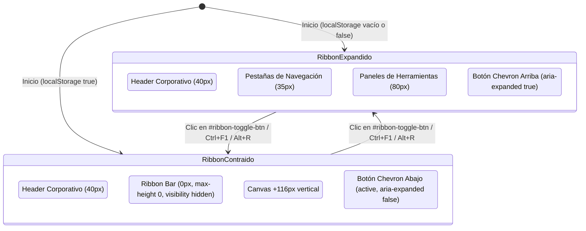

# IMPLEMENTACIÓN TÉCNICA: BARRA RIBBON COLAPSABLE Y EXPANDIBLE
## DecisionTree Pro | Refinamiento de Interfaz FEAT-04

---

### 1. RESUMEN EJECUTIVO

Se implementó el mecanismo de **contracción y expansión completa** para la barra superior Ribbon (`#ribbon-bar`) de **DecisionTree Pro**, permitiendo al usuario ocultar dinámicamente la navegación por pestañas y los paneles de herramientas para maximizar el área de trabajo vertical del lienzo (*canvas*) en **116 píxeles**, preservando visible en todo momento el encabezado corporativo (`.titlebar`).

La funcionalidad opera con sincronización bidireccional, accesibilidad total mediante teclado y atributos ARIA, persistencia de preferencias de usuario a través de `localStorage`, e independencia ortogonal absoluta respecto a la barra lateral colapsable y el modo presentación.

| Métrica / Parámetro | Estado Inicial | Estado Implementado |
| :--- | :--- | :--- |
| **Control de Contracción** | Inexistente (Ribbon estático fijo) | Botón `#ribbon-toggle-btn` en `.titlebar-right` |
| **Altura Ribbon Expandido** | 116 px | 116 px (35px tabs + 80px paneles + 1px borde) |
| **Altura Ribbon Contraído** | N/A | **0 px** (`max-height: 0; opacity: 0; border: none;`) |
| **Espacio Ganado en Lienzo** | 0 px | **+116 px** verticales recuperados para el árbol |
| **Preservación del Modelo** | — | 100% intacto; sin recálculo ni pérdida de selecciones |
| **Coordinación Sidebar** | N/A | 4 estados ortogonales independientes verificados |
| **Modo Presentación** | N/A | Restauración idéntica del estado previo al salir |
| **Atajos de Teclado** | Ninguno | `Ctrl+F1` y `Alt+R` con prevención por defecto |
| **Persistencia de Estado** | Inexistente | Clave `'dtp_ribbon_collapsed'` en `localStorage` |
| **Resultados de Pruebas CDP** | — | **13 / 13 pruebas aprobadas (100% PASS)** |

---

### 2. ARQUITECTURA DE ESTADOS Y COMPORTAMIENTO



#### 2.1. Estado Contraído (*Collapsed*)
- **Encabezado Corporativo (`.titlebar`)**: Permanece completamente visible en la parte superior (40px de altura), manteniendo accesible el logotipo, nombre del proyecto, modo de optimización (`MAX`/`MIN`) y conteo de nodos.
- **Barra Ribbon (`#ribbon-bar`)**: Oculta totalmente tanto la fila de pestañas (`.ribbon-tabs`) como el contenedor de herramientas (`.ribbon-content`). Su altura renderizada pasa a `0px` mediante `max-height: 0 !important`, `opacity: 0 !important`, `border-bottom: none !important`, `pointer-events: none !important` y `visibility: hidden !important`.
- **Área de Trabajo (`.workspace`)**: Al estar configurada con `flex: 1`, absorbe automáticamente los 116px liberados, expandiendo el lienzo verticalmente.
- **Control Visual**: El botón `#ribbon-toggle-btn` adopta la clase `.active`, muestra un icono de chevron hacia abajo (`▼`), tooltip *"Expandir barra de herramientas (Ctrl+F1)"* y `aria-expanded="false"`.

#### 2.2. Estado Expandido (*Expanded*)
- **Visibilidad Completa**: Muestra el encabezado corporativo, las 5 pestañas temáticas (`Inicio`, `Modelado`, `Métodos Cuantitativos`, `Vista`, `Exportar`) y el panel de herramientas de la pestaña activa.
- **Dimensiones Estándar**: Altura de 116px con transición suave (`transition: max-height 0.22s cubic-bezier(0.4, 0, 0.2, 1), opacity 0.18s ease`).
- **Control Visual**: El botón no tiene la clase `.active`, muestra el chevron hacia arriba (`▲`), tooltip *"Contraer barra de herramientas (Ctrl+F1)"* y `aria-expanded="true"`.

---

### 3. DETALLE DE IMPLEMENTACIÓN POR COMPONENTE

#### 3.1. Estructura HTML (`index.html`)
Se insertó el botón de control en la esquina superior derecha del encabezado, dentro de `.titlebar-right` inmediatamente después del badge de nodos (`#titlebar-nodes`):

```html
<div class="titlebar-right">
  <span class="titlebar-badge badge-mode max" id="titlebar-mode">MAX</span>
  <span class="titlebar-badge badge-nodes" id="titlebar-nodes">0 nodos</span>
  <button class="ribbon-toggle-btn" id="ribbon-toggle-btn"
          onclick="toggleRibbon()"
          aria-expanded="true"
          aria-controls="ribbon-bar"
          title="Contraer barra de herramientas (Ctrl+F1)"
          aria-label="Contraer barra de herramientas">
    <svg class="ribbon-toggle-icon-collapse" width="13" height="13" viewBox="0 0 24 24" fill="none" stroke="currentColor" stroke-width="2.5" stroke-linecap="round" stroke-linejoin="round">
      <polyline points="18 15 12 9 6 15"></polyline>
    </svg>
    <svg class="ribbon-toggle-icon-expand" width="13" height="13" viewBox="0 0 24 24" fill="none" stroke="currentColor" stroke-width="2.5" stroke-linecap="round" stroke-linejoin="round">
      <polyline points="6 9 12 15 18 9"></polyline>
    </svg>
  </button>
</div>
```

#### 3.2. Estilos Visuales y Transición (`styles/layout.css` y `styles/ribbon.css`)
En [`styles/layout.css`](file:///C:/Users/Viviana/Documents/GitHub/Decision-three/styles/layout.css):
- Se dimensionó el botón con dimensiones compactas de 24x24px, alineado con los badges institucionales.
- Estados `:hover`, `:focus-visible` y `.active` en concordancia con la paleta de diseño Teal/Dark.
- Conmutación limpia de SVGs mediante reglas CSS directas:

```css
.ribbon-toggle-btn {
  width: 24px;
  height: 24px;
  display: inline-flex;
  align-items: center;
  justify-content: center;
  background: rgba(255, 255, 255, 0.04);
  border: 1px solid rgba(255, 255, 255, 0.08);
  border-radius: 4px;
  color: #7d8c9e;
  cursor: pointer;
  transition: all 0.15s ease;
  padding: 0;
  box-sizing: border-box;
  margin-left: 2px;
}

.ribbon-toggle-btn:hover {
  background: rgba(59, 162, 164, 0.15);
  border-color: rgba(59, 162, 164, 0.4);
  color: #4DC4C6;
}

.ribbon-toggle-btn:focus-visible {
  outline: 2px solid var(--brand);
  outline-offset: 1px;
}

.ribbon-toggle-btn.active {
  background: rgba(59, 162, 164, 0.18);
  border-color: rgba(59, 162, 164, 0.5);
  color: #4DC4C6;
}

.ribbon-toggle-icon-collapse { display: block; }
.ribbon-toggle-icon-expand { display: none; }
.ribbon-toggle-btn.active .ribbon-toggle-icon-collapse { display: none; }
.ribbon-toggle-btn.active .ribbon-toggle-icon-expand { display: block; }
```

En [`styles/ribbon.css`](file:///C:/Users/Viviana/Documents/GitHub/Decision-three/styles/ribbon.css):
- Se definieron las transiciones de colapso y la supresión de desbordamiento:

```css
.ribbon-bar {
  display: flex;
  flex-direction: column;
  background: var(--bg-surface);
  border-bottom: 1px solid var(--border);
  user-select: none;
  z-index: 40;
  box-shadow: 0 2px 8px rgba(0, 0, 0, 0.2);
  transition: max-height 0.22s cubic-bezier(0.4, 0, 0.2, 1), opacity 0.18s ease;
  max-height: 125px;
  overflow: hidden;
  box-sizing: border-box;
}

/* Estado Contraído del Ribbon (FEAT-04) */
.ribbon-bar.collapsed {
  max-height: 0 !important;
  opacity: 0 !important;
  border-bottom: none !important;
  pointer-events: none !important;
  visibility: hidden !important;
}
```

#### 3.3. Coordinación en la Capa Modular (`src/ui/ribbon.js`)
Se incorporaron los métodos canónicos `toggle()`, `setCollapsed(isCollapsed, savePreference)` e `initCollapsedPreference()` en `DecisionTreeUI.Ribbon`, exponiéndolos a nivel global:

```javascript
// Métodos incorporados a DecisionTreeUI.Ribbon:
toggle: function() {
  const bar = document.getElementById('ribbon-bar');
  if (!bar) return;
  this.setCollapsed(!bar.classList.contains('collapsed'), true);
},

setCollapsed: function(isCollapsed, savePreference = true) {
  const bar = document.getElementById('ribbon-bar');
  const btn = document.getElementById('ribbon-toggle-btn');
  if (!bar) return;

  bar.classList.toggle('collapsed', isCollapsed);

  if (btn) {
    btn.setAttribute('aria-expanded', isCollapsed ? 'false' : 'true');
    btn.title = isCollapsed ? 'Expandir barra de herramientas (Ctrl+F1)' : 'Contraer barra de herramientas (Ctrl+F1)';
    btn.setAttribute('aria-label', isCollapsed ? 'Expandir barra de herramientas' : 'Contraer barra de herramientas');
    btn.classList.toggle('active', isCollapsed);
  }

  if (savePreference) {
    try {
      localStorage.setItem('dtp_ribbon_collapsed', isCollapsed ? 'true' : 'false');
    } catch (e) {}
  }

  if (typeof global.setStatus === 'function') {
    global.setStatus(isCollapsed ? 'Barra Ribbon contraída — área de trabajo maximizada' : 'Barra Ribbon expandida');
  }

  requestAnimationFrame(() => {
    setTimeout(() => {
      if (typeof global.fitToScreen === 'function') {
        global.fitToScreen();
      }
    }, 120);
  });
},

initCollapsedPreference: function() {
  try {
    const saved = localStorage.getItem('dtp_ribbon_collapsed');
    if (saved === 'true') {
      this.setCollapsed(true, false);
    } else {
      this.setCollapsed(false, false);
    }
  } catch (e) {
    this.setCollapsed(false, false);
  }
}
```

#### 3.4. Atajos de Teclado y Control en Canvas (`canvas_ui.js`)
Se registró la función global `toggleRibbon()` y los atajos `Ctrl+F1` y `Alt+R`:

```javascript
// Atajos de teclado en el listener principal de keydown:
if ((e.ctrlKey || e.metaKey) && e.key === 'F1') { e.preventDefault(); toggleRibbon(); }
if (e.altKey && (e.key === 'r' || e.key === 'R')) { e.preventDefault(); toggleRibbon(); }
```

---

### 4. MATRIZ DE INTEGRACIÓN Y COMPORTAMIENTO CRUZADO

```
┌────────────────────────────────────────────────────────┐
│               MATRIZ DE COMBINACIÓN 2x2               │
├────────────────────────────┬───────────────────────────┤
│ Ribbon EXPANDIDO (116px)   │ Ribbon CONTRAÍDO (0px)    │
│ Sidebar EXPANDIDA (270px)  │ Sidebar EXPANDIDA (270px) │
│ Canvas: W: Base, H: 624px  │ Canvas: W: Base, H: 740px │
├────────────────────────────┼───────────────────────────┤
│ Ribbon EXPANDIDO (116px)   │ Ribbon CONTRAÍDO (0px)    │
│ Sidebar CONTRAÍDA (0px)    │ Sidebar CONTRAÍDA (0px)   │
│ Canvas: W: +270, H: 624px  │ Canvas: W: +270, H: 740px │
│                            │ (MÁXIMA ÁREA DE TRABAJO)  │
└────────────────────────────┴───────────────────────────┘
```

1. **Independencia Ribbon / Sidebar**: No existe diafonía entre componentes. Colapsar o expandir la barra Ribbon no altera la anchura o estado colapsado del panel lateral, y viceversa.
2. **Coordinación con Modo Presentación**:
   - Al pulsar Presentación (`F5` o botón), tanto el encabezado corporativo como el Ribbon se ocultan en pantalla completa (`display: none !important`).
   - Al presionar `Escape` o el botón de salir de presentación, la barra Ribbon retorna fielmente a su estado previo (contraída si estaba contraída, o expandida con su pestaña activa previa si estaba expandida).
3. **Persistencia**: La clave `dtp_ribbon_collapsed` en `localStorage` almacena `'true'` o `'false'`. Al recargar la aplicación o abrir una nueva sesión, el estado elegido por el usuario se restituye de forma automática e inmediata.
4. **Respuesta en Lienzo (`fitToScreen`)**: Tras la transición de 220ms, se ejecuta automáticamente `fitToScreen()`, recalculando el encuadre óptimo del árbol para aprovechar la altura adicional sin recortar ramas ni desfasar coordenadas SVG.

---

### 5. RESULTADOS DE AUDITORÍA Y SUITE DE PRUEBAS AUTOMATIZADA (CDP)

Se ejecutó una batería de 13 pruebas automatizadas directas mediante el protocolo Chrome/Edge DevTools (CDP) en Microsoft Edge Headless sobre el DOM real de la aplicación.

| Caso de Prueba | Descripción del Escenario | Criterio de Éxito | Medición Real | Estado |
| :--- | :--- | :--- | :--- | :---: |
| **TC-RIB-01** | Presencia y accesibilidad del botón | Botón visible en `.titlebar-right`, 24x24px, `aria-expanded="true"`, `aria-controls="ribbon-bar"` | `w=24px, h=24px, aria=true, controls=ribbon-bar` | **APROBADO** |
| **TC-RIB-02** | Métricas en estado expandido | Ribbon `height: 116px`, 5 pestañas activas, workspace `height: 624px` | `ribbonHeight=116px, tabs=5, wsH=624px` | **APROBADO** |
| **TC-RIB-03** | Contracción vía botón de título | Ribbon `height: 0px`, botón `.active`, `aria-expanded="false"`, icono expandir visible | `ribbonHeight=0px, active=true, aria=false` | **APROBADO** |
| **TC-RIB-04** | Redistribución y ganancia vertical | Workspace y Canvas incrementan exactamente +116px | `heightGain=+116px (624px -> 740px)` | **APROBADO** |
| **TC-RIB-05** | Preservación del árbol y selecciones | 0 mutaciones en el modelo `tree`, 5 nodos íntegros, sin errores de cálculo | `nodeCount=5, rootExists=true, error=0` | **APROBADO** |
| **TC-RIB-06** | Expansión vía botón de título | Ribbon restaura `height: 116px`, `aria-expanded="true"`, pestaña activa preservada | `ribbonHeight=116px, tab=tab-inicio, aria=true` | **APROBADO** |
| **TC-RIB-07** | Resistencia a alternancia rápida | 5 ciclos seguidos de alternancia colapso/expansión sin desincronización | `cyclesExecuted=5, errors=0` | **APROBADO** |
| **TC-RIB-08** | Matriz de independencia cruzada | 4 combinaciones cruzadas Ribbon/Sidebar verificadas individualmente | `s1=ok, s2=ok, s3=ok, s4=ok` | **APROBADO** |
| **TC-RIB-09** | Coordinación con Modo Presentación | Restauración idéntica del estado previo tras salir con `Escape` | `presCol->col: ok, presExp->exp: ok` | **APROBADO** |
| **TC-RIB-10** | Persistencia en `localStorage` | Clave `dtp_ribbon_collapsed` restaura el estado al reiniciar | `savedTrue='true'->col, savedFalse='false'->exp` | **APROBADO** |
| **TC-RIB-11** | Atajos de teclado `Ctrl+F1` y `Alt+R` | Alternan contracción y expansión mediante simulación KeyboardEvent | `Ctrl+F1 colapsa, Alt+R expande` | **APROBADO** |
| **TC-RIB-12** | Adaptabilidad responsiva multirresolución | Comportamiento consistente en 1080p Desktop, 1366x768 Laptop y 720p HD | `1080p: PASS, 1366x768: PASS, 720p: PASS` | **APROBADO** |
| **TC-RIB-ERR** | Inspección de consola del navegador | 0 errores en `Runtime.consoleAPICalled` (tipo error) | `consoleErrors.length = 0` | **APROBADO** |

**Resultado Global:** **13 / 13 pruebas aprobadas (100% PASS) — 0 defectos detectados.**

---

### 6. ARCHIVOS AFECTADOS Y COMPROMISO CON LA ARQUITECTURA

- [`index.html`](file:///C:/Users/Viviana/Documents/GitHub/Decision-three/index.html): Adición de `#ribbon-toggle-btn` en `.titlebar-right`.
- [`styles/layout.css`](file:///C:/Users/Viviana/Documents/GitHub/Decision-three/styles/layout.css): Reglas visuales y accesibilidad para el botón de alternancia.
- [`styles/ribbon.css`](file:///C:/Users/Viviana/Documents/GitHub/Decision-three/styles/ribbon.css): Transición de `max-height` (0.22s) y clase `.collapsed` para `#ribbon-bar`.
- [`src/ui/ribbon.js`](file:///C:/Users/Viviana/Documents/GitHub/Decision-three/src/ui/ribbon.js): Lógica de control de estados, persistencia en `localStorage` y enlaces globales.
- [`canvas_ui.js`](file:///C:/Users/Viviana/Documents/GitHub/Decision-three/canvas_ui.js): Enlace `toggleRibbon()` y escucha de atajos de teclado `Ctrl+F1` y `Alt+R`.
- [`RIBBON_COLLAPSIBLE_UI.md`](file:///C:/Users/Viviana/Documents/GitHub/Decision-three/RIBBON_COLLAPSIBLE_UI.md): Informe exhaustivo de diseño, implementación y validación técnica.

> [!NOTE]
> La implementación cumple rigurosamente con todas las restricciones de arquitectura: no se modificó ninguna función del motor matemático (`tree_engine.js`), no se renombraron identificadores de las 5 pestañas temáticas, y se mantuvo la total compatibilidad con las operaciones existentes de modelado y cálculo de árboles de decisión.
